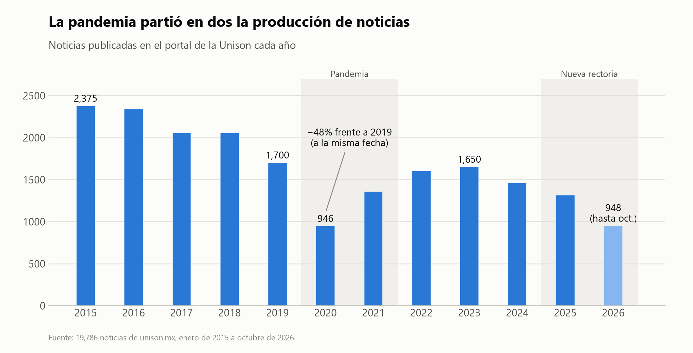
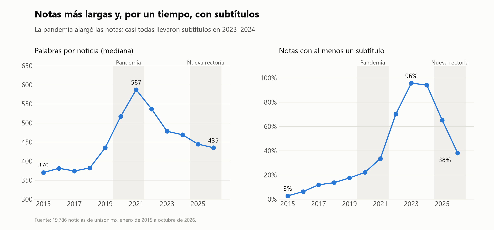
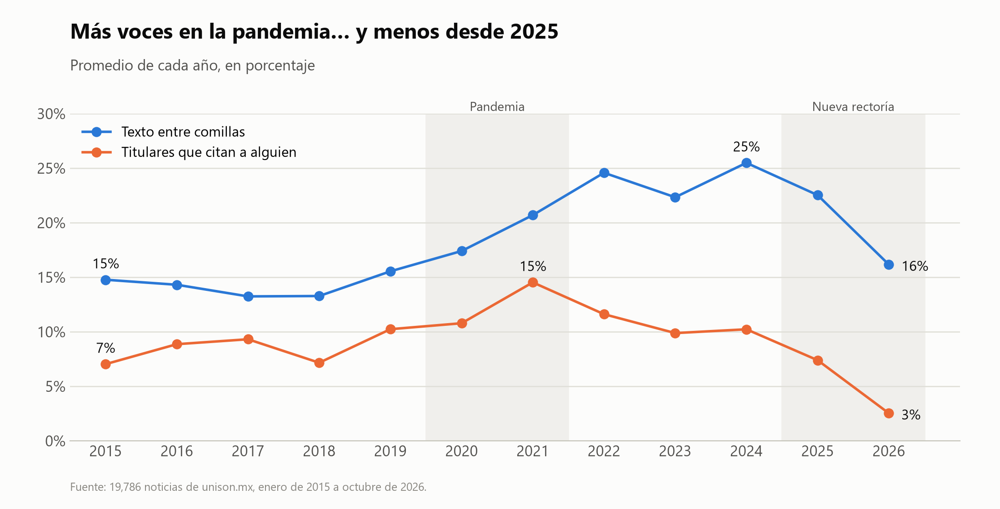
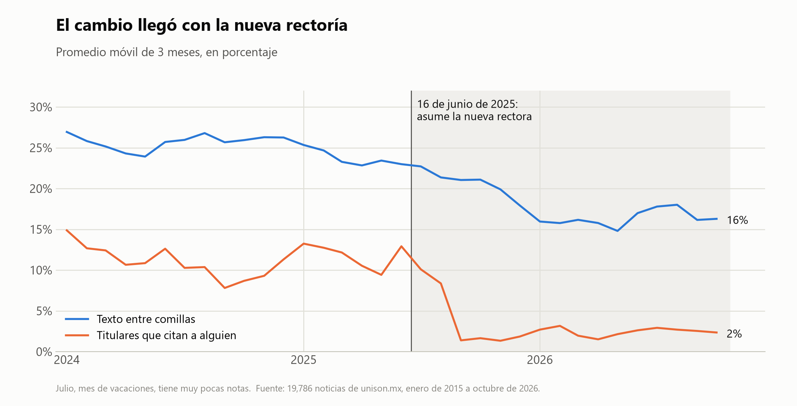
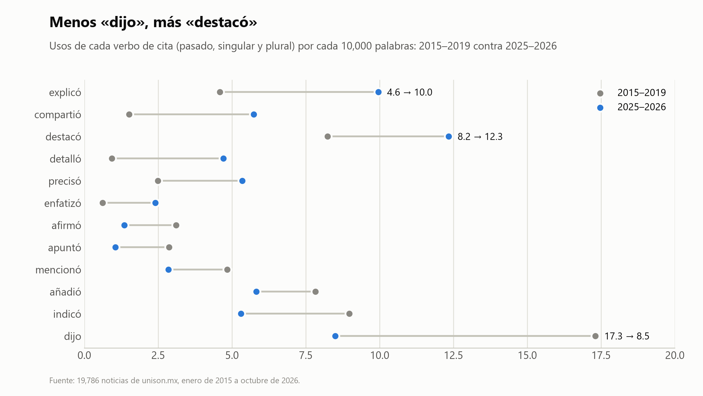
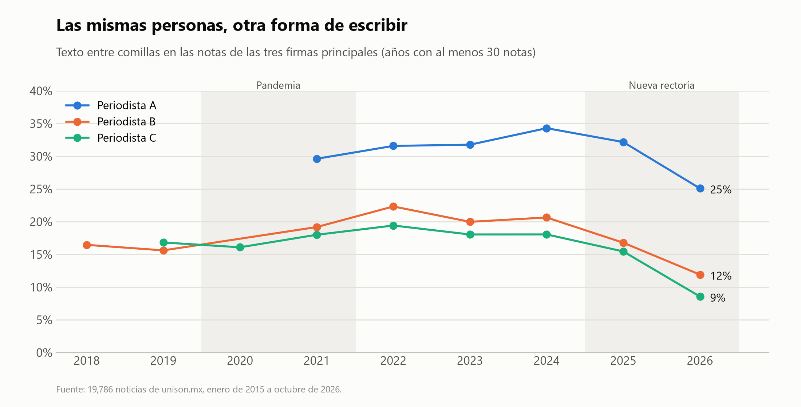
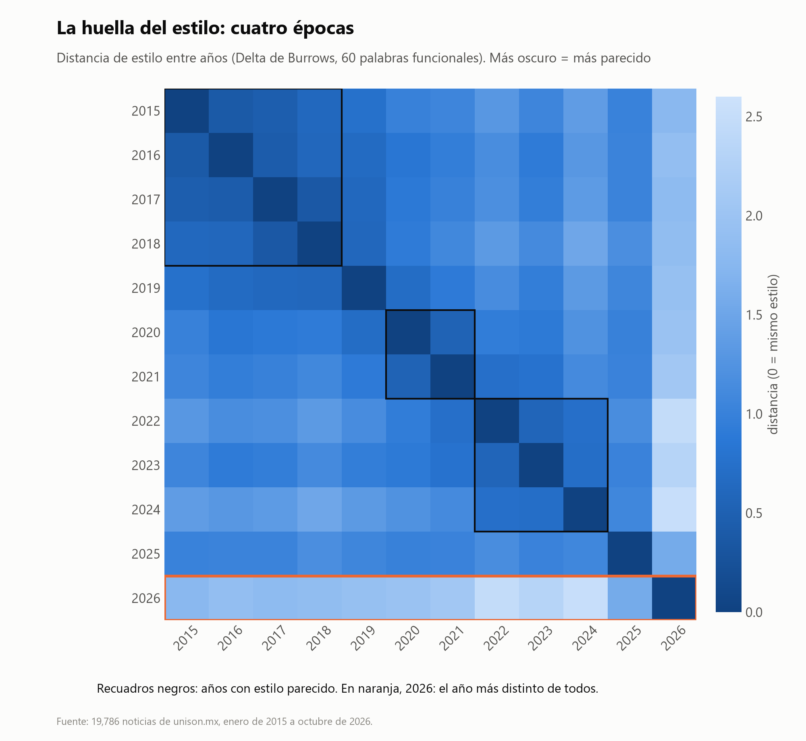
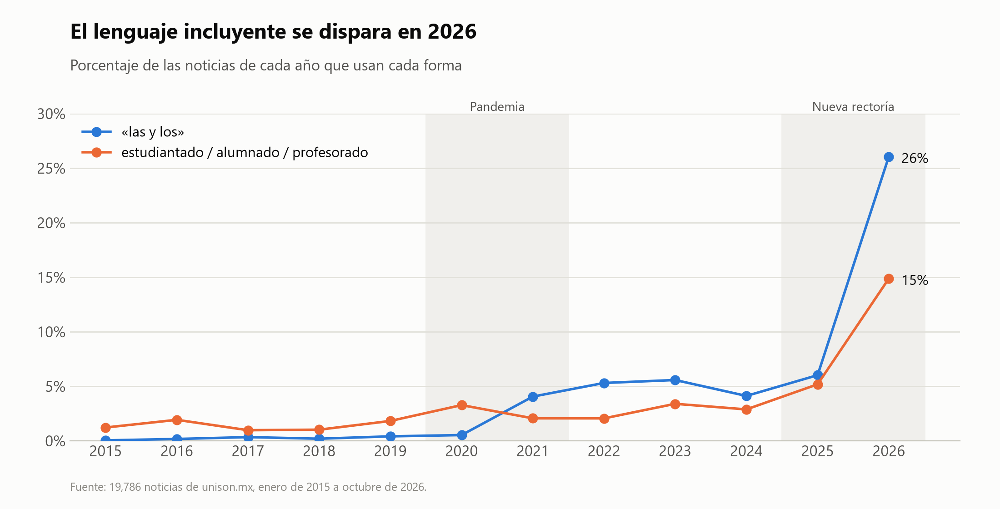

# Cómo la pandemia cambió la manera de escribir de la Universidad de Sonora

### Analicé casi 20 mil noticias de la Unison publicadas entre 2015 y 2026. La pandemia las hizo más largas y llenas de voces; en 2025, las voces casi desaparecieron.

---

Cada día que publica, el portal de noticias de la Universidad de Sonora sube entre cuatro y ocho notas: un congreso, un premio, un convenio, la visita de una especialista. Son textos que pocas personas leen completos y que, sin embargo, guardan algo valioso: más de una década de la forma en que una institución se cuenta a sí misma.

Descargué las noticias publicadas en unison.mx entre enero de 2015 y octubre de 2026, me quedé con **19,786** después de limpiarlas y, en lugar de preguntarme solo *de qué* hablan, me pregunté *cómo* están escritas. ¿Cuántas se publican? ¿Qué tan largas son? ¿A quién citan? ¿Con qué verbos? Hasta las palabras más pequeñas —*de, la, que, los*— dejan una huella.

La respuesta tiene dos quiebres: la pandemia y, cinco años después, un cambio de rectoría.

---

## 1. Menos noticias, de golpe

*En 2020 el portal publicó 48% menos noticias que en 2019 a la misma fecha.*

Antes de la pandemia, la Unison publicaba entre 1,700 y 2,400 noticias al año. En 2020 la producción se partió en dos: al 29 de octubre había **697 notas, contra 1,328 del año anterior**. Solo dos de cada tres días tuvieron alguna noticia, y por primera vez se publicó con frecuencia en fin de semana (7% de las notas, contra 2–5% antes).

La recuperación llegó, pero a medias: desde 2022 el portal publica entre 1,300 y 1,650 notas al año, y en 2026 va 14% abajo de 2025. El equipo también es más chico: hoy firman seis periodistas y **tres personas escriben casi ocho de cada diez notas**.

## 2. Notas más largas y, por un tiempo, con subtítulos

*La pandemia alargó las notas. Y de agosto de 2022 a abril de 2025, casi todas llevaron subtítulos.*

Con menos eventos que cubrir, las notas crecieron: la nota típica pasó de **370 palabras en 2015 a 587 en 2021**, con más párrafos y oraciones más largas. Después se fueron acortando hasta unas 440 palabras.

El otro cambio llegó de golpe: los **subtítulos**. En 2015 solo 3% de las notas tenía alguno, y en 2021, una de cada tres. En los primeros siete meses de 2022 eran 51%; desde agosto de ese año y hasta abril de 2025 fueron **94%**. Un salto tan brusco parece una decisión de formato, más que un hábito que se contagia poco a poco.

## 3. La pandemia llenó las notas de voces

*De 2022 a 2024, una cuarta parte del texto de las notas eran palabras de otras personas, entre comillas.*

El cambio más interesante no está en el tamaño, sino en **quién habla**. Por *voces* me refiero a las palabras de otras personas que una nota reproduce tal cual, en lugar de contarlas con las palabras de la universidad: lo que dicen la rectora, un investigador o una estudiante, entre comillas o en el titular. Antes de la pandemia, entre 13% y 16% del texto de una nota estaba entre comillas. Durante y después de la pandemia esa proporción llegó a **22–25%**, y casi nueve de cada diez notas incluían al menos una cita.

También los titulares se llenaron de voces. Un estilo muy común es la frase seguida del nombre de quien la dijo: *"Unison, pionera en donación altruista de sangre: rectora"*. En 2021, **15% de los titulares** tenían esa forma. Una explicación posible: sin eventos presenciales, las noticias se construyeron a partir de entrevistas, conversatorios y conferencias en línea.

## 4. 2025: las voces se apagan

*Los titulares que citan a alguien caen de cerca de 11% a 2% justo después del cambio de rectoría.*

El 16 de junio de 2025 asumió la rectoría Dena María Camarena Gómez. Mes por mes, el cambio es visible casi de inmediato: los titulares que citan a alguien pasan de **11% (enero de 2024 a mayo de 2025) a 2% a partir de agosto**, y el texto entre comillas baja de 25% a 18%, hasta quedar en 16% en todo 2026. En 2026, **solo 3% de los titulares** sigue esa fórmula de la frase y quien la dijo.

Los subtítulos también se van: en esos mismos periodos pasan de **91% de las notas a 41%**.

No solo hay menos citas: también cambia la manera de presentarlas.

*"Dijo" se usa la mitad que antes; "destacó", "explicó", "compartió" y "detalló" crecen.*

El verbo que acompaña una cita no es neutral. *Dijo* solo informa; *destacó*, *subrayó* o *compartió*, en mi lectura, ya valoran lo que se dice. Contando cada verbo en pasado, en singular y plural, en 2025–2026 **"dijo" se usa la mitad** que en 2015–2019 (de 17.3 a 8.5 veces por cada 10,000 palabras), mientras que *destacó* sube de 8.2 a 12.3, *explicó* se duplica, *compartió* casi se cuadruplica y *detalló* se multiplica por cinco. Parte de este cambio viene de antes —*explicó* y *detalló* crecen desde la pandemia—, pero la caída de *dijo* es de los últimos dos años.

## 5. No cambió el equipo: cambió la línea editorial

Hay dos maneras de que el estilo de un medio cambie: que lleguen periodistas nuevos o que las mismas personas escriban distinto. Para distinguirlas, comparé a cada una de las tres firmas principales consigo misma a lo largo de los años.

*Las tres firmas que escriben la mayoría de las notas citan menos en 2026 que en 2024.*

El resultado es claro: **las mismas tres personas** que escriben casi 80% de las notas citan menos en 2026 que en 2024 (de 34% a 25%, de 21% a 12% y de 18% a 9% del texto), usan "dijo" la mitad de veces o menos, escriben muchos menos titulares con cita y dejaron los subtítulos en buena parte de sus notas (de 94–97% de ellas a 25–49%). Cuando las mismas personas cambian su forma de escribir al mismo tiempo, lo que cambió no fue el equipo, sino **la línea editorial**.

## 6. La huella en las palabras pequeñas

Para analizar temas se suelen quitar las palabras más comunes (*de, la, que, los...*), porque no dicen de qué trata un texto. Para analizar el **estilo** son justo lo que importa: casi nadie decide a propósito cuántas veces escribe *los* o *con*, y esas costumbres forman una especie de huella. Para medirla usé un método clásico, la **Delta de Burrows**, creado en 2002 para identificar autores. Aquí lo uso para comparar años.

Funciona en tres pasos:

1. **Contar.** Para cada año, cuántas veces aparece cada una de las 60 palabras funcionales más comunes (como *de, la, que, los*) por cada 1,000 palabras de texto.
2. **Comparar con lo normal.** Cada conteo se convierte en un puntaje que dice cuánto se aleja ese año de lo habitual para esa palabra: 0 es lo normal, un número positivo es más de lo normal y uno negativo, menos. Así pesan igual *en*, que aparece unas 31 veces por cada 1,000 palabras, y *quienes*, que aparece menos de una.
3. **Medir la distancia.** Para comparar dos años se calcula la diferencia entre sus puntajes, palabra por palabra, y se promedia. Ese promedio es la Delta: cerca de 0, el estilo es casi igual; entre más grande, más distinto.

Un ejemplo con una sola palabra: *los* aparece unas 16.5 veces por cada 1,000 palabras tanto en 2015 como en 2016, pero solo 13.1 en 2026. En puntajes, eso es +1.0 y +1.1 contra −2.5. La diferencia entre 2015 y 2016 es de apenas 0.1; entre 2015 y 2026, de 3.5. Al promediar las 60 palabras, la distancia entre 2015 y 2016 queda en **0.39**, y entre 2015 y 2026, en **1.78**.

Sin decirle al método nada sobre la pandemia ni sobre la rectoría, los años se agrupan solos en épocas:

*Cada cuadro compara dos años; más oscuro significa un estilo más parecido. 2026 es el año más distinto de todos.*

Aparecen tres bloques —2015–2018, la pandemia y 2022–2024—, con 2019 y 2025 como años de transición. Y **2026 queda lejos de todos los demás**. Entre las palabras que más cambian, sube *quienes* y bajan *los* y *otros*: la huella de una forma de escribir que evita el masculino genérico (*quienes estudian* en lugar de *los estudiantes*).

Una advertencia: las palabras de tema agrupan los años de forma parecida, así que la Delta no prueba por sí sola que el estilo cambió aparte de los temas. Sirve como apoyo; la evidencia más directa son las citas, los subtítulos y los verbos de las mismas personas.

*"Las y los" aparece en una de cada cuatro notas de 2026.*

El lenguaje incluyente venía creciendo poco a poco desde 2021, pero en 2026 se dispara: **"las y los" pasa de casi 0% de las notas en 2015 a 26%**, y *estudiantado*, *alumnado* o *profesorado* aparecen en 15% de las notas, contra 1% al inicio. En el mismo periodo, la palabra *alumno* pasó de estar en 40% de las notas a 20%.

## 7. ¿Qué nos dicen estas noticias?

Las noticias institucionales no son un contenedor neutral: su forma responde a las circunstancias y a las decisiones de quien las publica. La pandemia, con menos eventos y más conversaciones a distancia, produjo notas más largas y llenas de voces. Después, casi todas adoptaron de golpe un formato con subtítulos. Y a mediados de 2025, el cambio de administración coincide con otro estilo: menos citas, titulares que casi no citan a nadie, menos subtítulos, verbos que realzan y un lenguaje más incluyente, escrito por las mismas personas.

Hay que decirlo con cuidado: los datos muestran que los cambios **coinciden en el tiempo**, no por qué ocurrieron. No entrevisté a nadie del equipo de comunicación, y una decisión editorial puede tener muchas razones. Pero la próxima vez que lea una nota del portal, quizá se pregunte lo mismo que yo: ¿quién habla aquí, y quién ya no?

---

### Cómo lo hice

- **Datos:** un *scraper* en Python (`requests` y `BeautifulSoup`) recorrió las noticias de unison.mx por su número de identificación, de enero de 2015 a octubre de 2026: 19,925 noticias válidas.
- **Limpieza:** quité las notas casi vacías (menos de 30 palabras) y los textos repetidos, y quedaron 19,786. También quité firmas, enlaces, correos y líneas sin contenido, y unifiqué las variantes de nombre de cada firma. Antes de 2018 las notas no tenían el nombre completo, sino las iniciales al final (*(JAR)*, *(BE)*).
- **Medidas de estilo:** palabras, párrafos, subtítulos y oraciones por nota; texto entre comillas; titulares con cita; frecuencia de 25 verbos de cita, en pasado, singular y plural. No lematicé ni quité acentos: habría borrado parte de lo que se mide (*las y los* se convierte en *el y el*).
- **Estilometría:** Delta de Burrows con las 60 palabras funcionales más frecuentes (lista de *stopwords* de NLTK), por año. Burrows usa las palabras más frecuentes sin filtrar; yo dejé solo las funcionales para que no pesen temas como *universidad*. Con su lista, el resultado casi no cambia (correlación de 0.98). A cada periodista lo comparé consigo mismo con las medidas de estilo.
- **Limitaciones:** las oraciones, los subtítulos y los titulares con cita se detectan con reglas sencillas (sirven para comparar años, no como valores exactos), y los titulares solo captan la forma *"frase: quien la dijo"*; las citas se detectan por las comillas, así que incluyen algunos títulos de eventos, sin que cambie la curva; 2026 está incompleto.

El scraper y el notebook con todo el análisis (`analisis_noticias_unison.ipynb`) están en GitHub: [github.com/Mario-ACL/PLN_UnisonNewsScrapping](https://github.com/Mario-ACL/PLN_UnisonNewsScrapping). Este análisis es un proyecto para la clase de Procesamiento de Lenguaje Natural.
